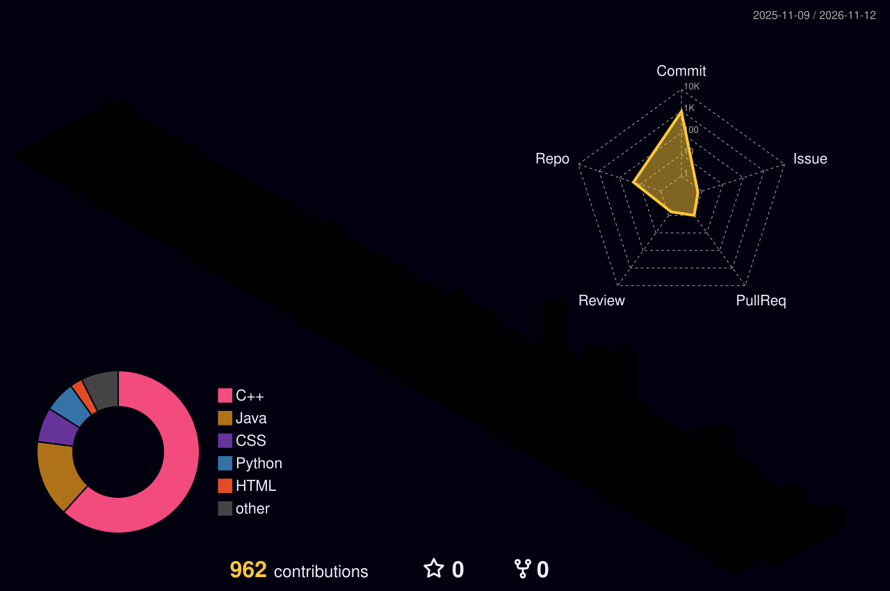

<div align="center">


<br/>


[](mailto:sunilkumar62001197@gmail.com)
[](https://linkedin.com/in/sunil-kumar-sky123/)
[](https://sunil-portfolio-2026.vercel.app/)
[](https://leetcode.com/u/Qt2HsgLHgH/)
[](https://codeforces.com/profile/sunilemail10)

</div>

##  About

-  Pre-final-year B.Tech CSE @ Galgotias University
-  Building full-stack apps (MERN) and AI tools (Python)
-  AWS ImpactX Finalist, IIT Bombay Techfest 2025
-  Open to internships, collabs & hackathons

```js
const sunil = {
  building: "AttendX - AI attendance with face + voice recognition",
  learning: ["System Design", "Advanced DSA", "AI/ML"],
  askMeAbout: ["MERN", "DSA in Java/C++", "Hackathons"],
  reach: "sunilkumar62001197@gmail.com",
};
```

##  Projects
*(click karke khol)*

<details open>
<summary><b> SkyGPT</b> — AI chat platform</summary>
<br/>

Gemini API based chat with **JWT + OAuth 2.0** auth.
`React` `Node.js` `Express` `MongoDB`

[🔗 Live](https://u-sky-gpt.vercel.app/login) · [📂 Code](https://github.com/wineerteam/skygpt)

</details>

<details>
<summary><b> AI ATS Resume Scorer</b> — resume vs JD matching</summary>
<br/>

Semantic matching with a downloadable **PDF report**.
`Python` `FastAPI` `Streamlit` `Docker`

[🔗 Live](https://ai-resume-ats-scorer-pw3ws5usjnha5pdz9uyswx.streamlit.app/) · [📂 Code](https://github.com/wineerteam/AI-Resume-Ats-Scorer)

</details>

<details>
<summary><b> AttendX</b> — face + voice attendance <i>(in progress)</i></summary>
<br/>

AI attendance system using face and voice recognition.
`Python` `Streamlit` `OpenCV` `Supabase`

[🔗 Demo](https://tinyurl.com/aisky11)

</details>

##  Tech Stack


##  Live Stats

<div align="center">


</div>

## 🌐 3D Contribution Graph

<div align="center">



</div>

## 💬 Random Dev Vibes
*(page refresh kar, har baar naya aayega)*

<div align="center">


</div>

<details>
<summary><b>🐍 Contribution Snake (bonus)</b></summary>
<br/>

<picture>
  <source media="(prefers-color-scheme: dark)" srcset="https://raw.githubusercontent.com/wineerteam/wineerteam/output/github-snake-dark.svg" />
  
</picture>

</details>

<div align="center">


</div>
